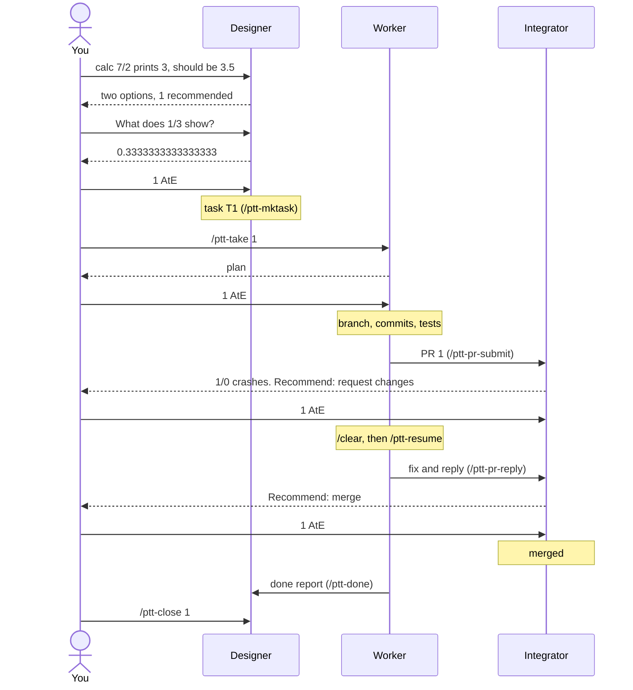
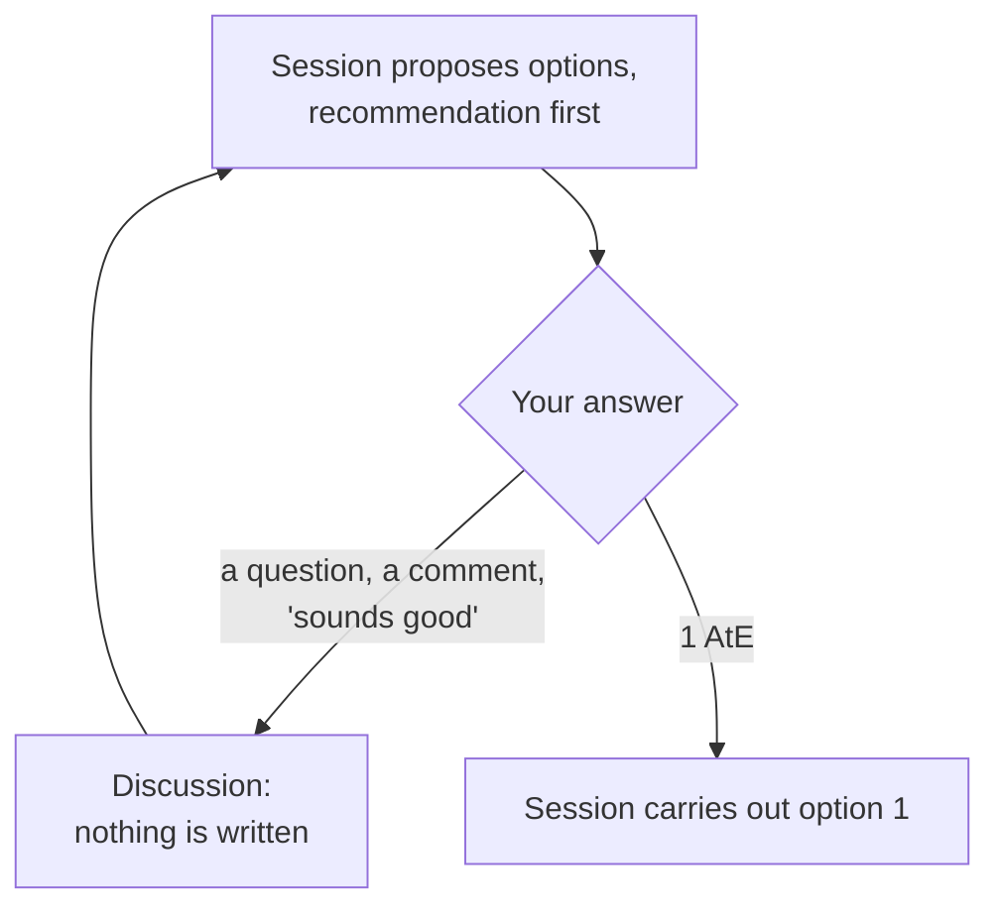
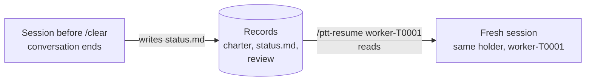

# Getting started

This guide follows one small project from a wish to a merge and explains,
on the way, why Partitur works as it does. It takes about ten minutes to
read. You need no other document: whatever is unclear later, ask a
session, which reads the rest for you.

## The project

`calc` is a tiny command-line calculator:

```
$ calc 2+3*4
14
$ calc 7/2
3
```

The second answer is wrong for your purposes: you want `3.5`. That is the
whole story: one wish, one change, one review comment, one decision.

You are the *user*: the one person in charge. Partitur is installed (best
by asking a session to do it, rather than working out a manual install;
see the [README](README.md)), and at least three sessions are open in the
project's workspace root:

- the *designer*, which plans: it turns your wishes into tasks, and
  answers for them;
- the *integrator*, which reviews finished work and carries out your
  decisions on it;
- a third session, still free, which will do the work.

The whole story on one page; the sections below take it step by step:



## 1. You say what you need; the designer proposes

In the designer's session you write: "`calc 7/2` prints 3. It should
print 3.5."

The designer reads the code before it answers. It does not change
anything; it comes back with what it found and a choice:

```
Division truncates: `7/2` gives 3. Should an exact result stay a whole number?
1. (recommended) Whole number when exact: 6/2 gives 3, 7/2 gives 3.5
2. Always a decimal: 6/2 gives 3.0
3. No decision, discuss further
```

**You decide; sessions propose.** A session discusses, investigates, and
recommends, but writes nothing until you approve. Approval has a fixed
form: an option number with `AtE`, "approval to execute". Anything else,
even "sounds good", is discussion. That keeps you free to think aloud.



So you ask first: "What does `1/3` show?"

The designer answers: "`0.3333333333333333`, as many digits as Python
prints. Rounding would be a separate decision; I would not mix it in." The
choice stands as before. You may keep asking like this until the
recommendation is clear; nothing happens meanwhile.

You answer `1 AtE`.

The designer now writes down what was agreed as a *task*: `T1`, with a
*charter*, the document that says what the task is for, what is in and
out of scope, and how its result will be checked ("`7/2` prints `3.5`,
`6/2` prints `3`, tests pass"). Writing a record is itself something you
approve, by typing the command: `/ptt-mktask` shows you the draft, and
`/ptt-mktask release 1` makes the task ready to be taken.

## 2. One session, one role

In the third session you type `/ptt-take 1`. The session is now
`worker-T0001`, the holder of task T1, and nothing else: it does not also
review, and it does not plan other tasks. A task held by one session
cannot be taken by another. That is how several sessions work side by
side without overwriting each other's files or decisions. In Claude
Code, `/ptt-take` also prints a `/rename` line: type it, so that messages
from other sessions reach this one.

The worker reads the charter and the code, then shows you a plan: one
commit that changes division and adds tests for `7/2`, `6/2`, and `1/3`;
what could go wrong; what it does not know yet. It ends with the same
kind of choice, and again writes nothing until you answer `1 AtE`. It
then works on its own branch, in its own copy of the code (a Git
worktree), so the main branch stays untouched.

## 3. A request, a review, a decision

When the work is done and the tests pass, you type `/ptt-pr-submit
draft`: the worker shows you a *request*, the branch with what it changes
and how it was tested. If it reads right, `/ptt-pr-submit` sends it. It
becomes request 1 (`PR 1`): a local request, kept in the records, with no
website involved.

In the integrator's session you type `/ptt-pr-review 1`. The integrator
reads the change, runs the tests itself, and writes a review. It has one
comment:

> `calc 1/0` now ends with a Python traceback. It should print an error
> and exit with status 1. Tested: 9 tests passed; `1/0` tried by hand.

and a recommendation:

```
Request 1: what happens to it?
1. (recommended) Request changes: division by zero must fail cleanly
2. Merge as it is
3. No decision, discuss further
```

**Review recommends; you decide.** Nothing reaches the main branch on a
session's judgment alone. You answer `1 AtE`, and the integrator records
your decision with the review.

Notice "Tested" in the comment. **Labels say how sure a claim is.**
*Tested* means it was run and seen; *Source* means it was read in the
code; *Documented* means a document says so; *Inferred* means it was
reasoned out; *Unknown* is said out loud rather than guessed. Decisions
are labelled too: *Agreed* is only what you agreed, in the words you
agreed; *Proposed* is a session's suggestion; *Open* is not decided yet.
When you read a report, the labels tell you where to look twice.

## 4. Clear the session; the records remain

The worker's conversation is long by now. At a quiet point, usually
after a decision, when no question is open, it offers to be cleared. It
first checks that nothing it wrote is uncommitted, and it has noted
where it stands in its task's `status.md`.

You type `/clear`, then `/ptt-resume worker-T0001`. The fresh session
has no memory of the conversation, and needs none: it reads the charter,
its `status.md`, and the review, and says where it stands: "PR 1 needs a
change: `1/0` must print an error."

**Records, not memory.** Everything that matters is in files in the
records repository (the project's notebook, a Git repository of its own):
charters, status, requests, reviews, decisions. Any session can end at
any time, and the next one continues from the records. The same holds
when a session crashes.



The worker answers the review: `/ptt-pr-draft-reply` shows you the fix it
plans and the reply it will send; `/ptt-pr-reply` carries it out. The
integrator reviews again (`/ptt-pr-review 1`): the comment is resolved,
the tests pass, and it recommends merging. You answer `1 AtE`, and the
integrator merges.

## 5. Done, and checked by the one who asked

The worker reports the task done with `/ptt-done`, naming each check in
the charter and its evidence. In the designer's session you type
`/ptt-close 1`: the designer compares the report with the charter and
closes the task, or says what is missing.

**A supervisor answers for what is below it.** The designer made T1, so
the designer checks it; you supervise the designer and the integrator.
A session leaves its task only with its supervisor's approval, never
while something below it waits on it, and a supervisor notices a
silent holder. Nothing falls between sessions.

That is the whole cycle. Larger projects run many such tasks at once, and
sessions pass each other notes and nudges (short messages that a session's
inbox has news), but every step is one of the five above.

## The ideas behind it

Partitur's rules aim at three things:

- **Authority**: you decide, and every decision is visible. Sessions
  propose; `AtE` approves; a question is never an approval.
- **Persistence**: work survives the end of any conversation. One
  session holds one role; records outlive memory; a supervisor keeps
  track of what is below it.
- **Evidence**: you can tell how much a claim is worth. Reviews and
  labels show what was tested, read, inferred, or unknown.

That is also the test for a new rule. Before Partitur adds one, it asks:
does this serve authority, persistence, or evidence? Or does it only make
up for a weakness of today's models, which tomorrow's may not have? The
first kind belongs in the method; the second is a workaround, and the
first to go when it is no longer needed. Partitur labels its own rules
the same way: *Exercised* once used in a real project, *Adopted* once
written into a project's rules but not yet shown in use, *Proposed* while
it is design only, untested ([rules index](rules.md)).

## What you type, and what you need not

You talk to sessions in your own words, and you approve with `AtE`. The
commands, all starting with `/ptt-` (`$ptt-` in Codex), are listed in the
[README](README.md#everyday-commands). Besides those in the example,
these are the ones used most:

- `/ptt-take` and `/ptt-resume` to start or continue a session;
- `/ptt-inbox` or `/ptt-brief` to ask a session what is new and what
  needs you;
- but you need not remember any command: when a session wants a record
  approved, it tells you which command to type.

You need not read the records, the code, or the rest of Partitur's
documents. Ask: "What is waiting for me?", "Why do you recommend that?",
"What does the integrator do?". A session reads what it needs and
answers.
