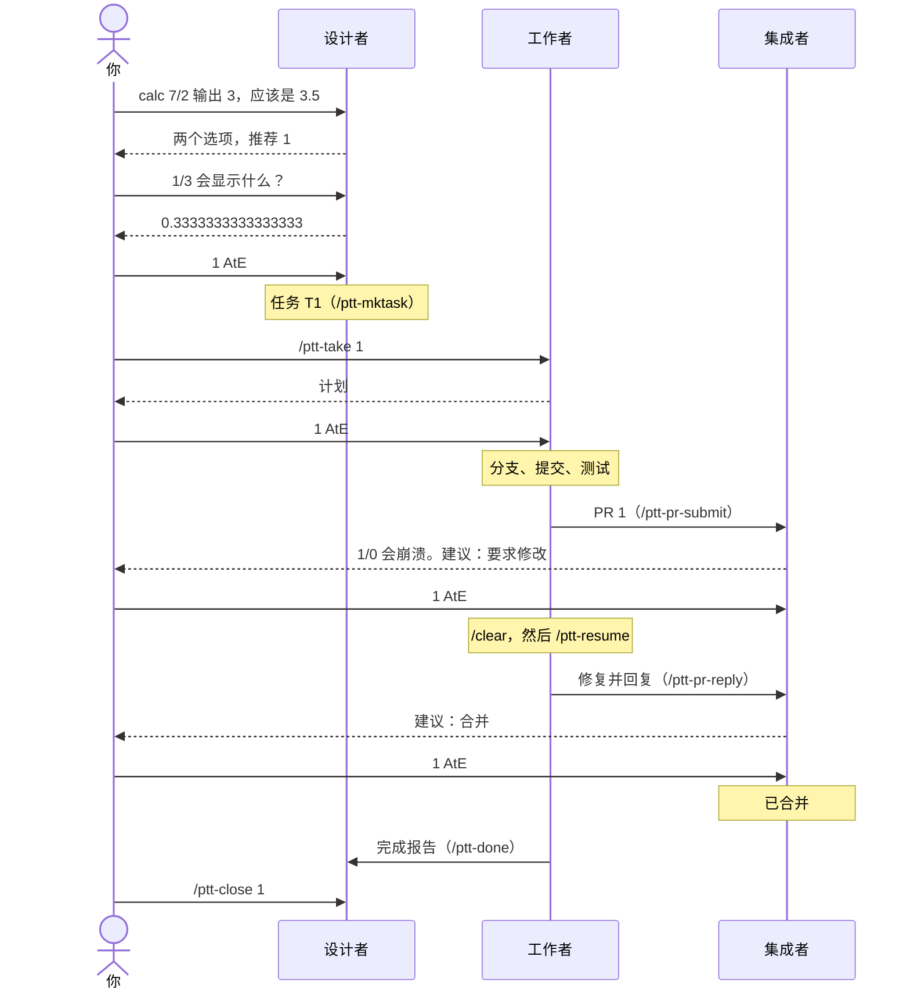
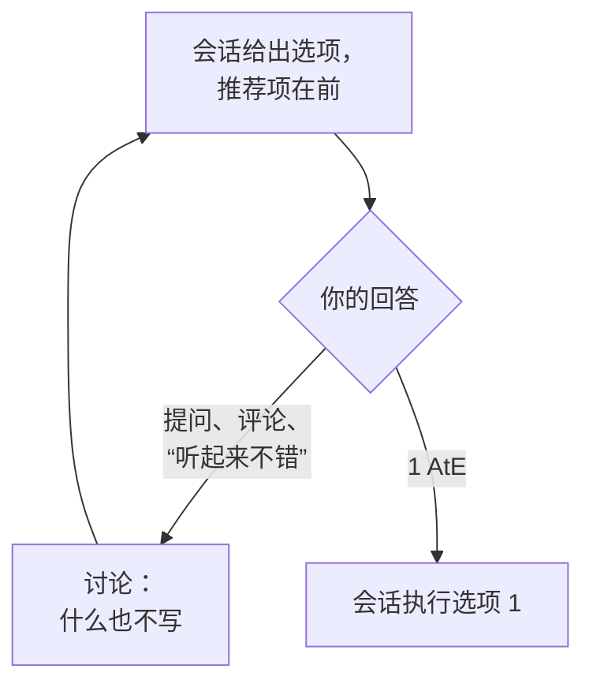
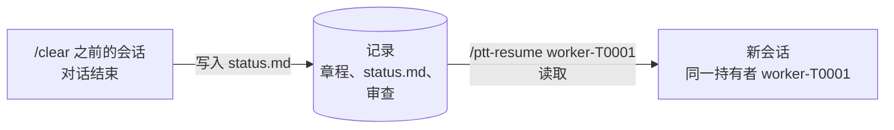

# 上手指南

[English](GETTING-STARTED.md)

本指南跟随一个小项目，从一个需求一直走到合并，并在途中解释 Partitur
为什么这样运作。大约十分钟读完。你不需要读其他文档：以后有什么不清楚的，
问AI就好，它会替你读其余的部分。内容以英文版为准。

## 项目

假设 `calc` 是一个很小的命令行计算器：

```
$ calc 2+3*4
14
$ calc 7/2
3
```

第二个结果不是你要的：你想要 `3.5`。整个故事就是这些：一个需求、一处改动、
一条审查意见、一个决定。

你是*用户*（user）：唯一做主的人。Partitur 已经装好（安装首选也让AI来装，不用自己研究怎么手工安装，
见 [README](README.zh-CN.md)），项目的工作区根目录里要打开至少三个会话：

- *设计者*（designer），负责规划：把你的需求变成任务，并对这些任务负责；
- *集成者*（integrator），审查完成的工作，执行你对它的决定；
- 第三个会话，还空着，将来干活。

整个故事画在一页上，下面各节再一步步展开：



## 1. 你说需要什么，设计者提出方案

你在设计者的会话里写：“`calc 7/2` 输出 3，应该输出 3.5。”

设计者先读代码再回答。它什么都不改，带回它查到的情况和一个选择：

```
除法会截断：`7/2` 得 3。能整除的结果要不要保持整数？
1.（推荐）能整除时给整数：6/2 得 3，7/2 得 3.5
2. 一律给小数：6/2 得 3.0
3. No decision, discuss further
```

**你来决定，会话来提议。** 会话可以讨论、调查、给出建议，但在你批准之前不会修改代码，也不会写任何记录。
批准有固定的形式：选项编号加 `AtE`（approval to execute，批准执行）。
其他任何回答，哪怕是“听起来不错”，都算讨论。这样你可以放心地边想边说。



于是你先问：“`1/3` 会显示什么？”

设计者回答：“`0.3333333333333333`，Python 打印多少位就显示多少位。
要不要四舍五入是另一个决定，我不建议混在一起。”选择还是原来那个。
你可以这样一直问，直到推荐理由清楚为止；在此期间什么都不会发生。

你回答 `1 AtE`。

设计者把商定的内容写成一个*任务*（task）：`T1`，附带一份*章程*（charter），
写明任务的目的、范围内外各有什么、结果怎样验收（“`7/2` 输出 `3.5`，
`6/2` 输出 `3`，测试通过”）。写一条记录本身也要你批准，方式是输入命令：
`/ptt-mktask` 给你看草稿，`/ptt-mktask release 1` 让任务可以被领取。

## 2. 一个会话，一个角色

你在第三个会话里输入 `/ptt-take 1`。这个会话现在是 `worker-T0001`，
任务 T1 的持有者，仅此而已：它不兼做审查，也不规划别的任务。
一个会话持有的任务，另一个会话领取不了。几个会话就是这样并肩工作，
而不会互相覆盖文件或决定。在 Claude Code 中，`/ptt-take` 还会打印一行 `/rename`：
输入它，其他会话的消息才能送达这个会话。

工作者（worker）读完章程和代码，给你看计划：一个提交，修改除法，
并为 `7/2`、`6/2` 和 `1/3` 加测试；可能出什么问题；还有什么不知道。
最后同样给出选择，在你回答 `1 AtE` 之前同样什么也不写。然后它在自己的分支上、
在自己的一份代码副本（Git 工作树，worktree）里工作，主分支不受影响。

## 3. 请求、审查、决定

工作完成、测试通过后，你输入 `/ptt-pr-submit draft`：工作者给你看一份*请求*
（request），即这个分支改了什么、怎样测试的。看着没问题，就用 `/ptt-pr-submit`
发出。它成为请求 1（`PR 1`）：一个本地请求，保存在记录里，不涉及任何网站。

你在集成者的会话里输入 `/ptt-pr-review 1`。集成者读改动，自己跑测试，
写出审查。它只有一条意见：

> `calc 1/0` 现在以一段 Python 错误堆栈（traceback）结束。它应该打印一条错误
> 并以状态 1 退出。Tested：9 项测试通过；`1/0` 手动试过。

以及一个建议：

```
请求 1：怎么处理？
1.（推荐）要求修改：除以零必须干净地报错
2. 原样合并
3. No decision, discuss further
```

**审查给出建议，由你决定。** 任何东西都不会只凭一个会话的判断进入主分支。
你回答 `1 AtE`，集成者把你的决定和审查一起记录下来。

注意意见里的“Tested”。**标签说明一个说法有多可靠。**
*Tested*（已测试）表示跑过、亲眼看到；*Source*（源代码）表示从代码里读到；
*Documented*（有文档记载）表示文档里这样写；*Inferred*（推断）表示推理得出；
*Unknown*（未知）就明说未知，而不是去猜。
决定也有标签：*Agreed*（已同意）只包括你同意的内容，且以你同意的措辞为准；
*Proposed*（提议）是会话的建议；*Open*（待定）表示还没决定。
读报告时，标签告诉你哪里值得多看一眼。

## 4. 清空会话，记录还在

工作者的对话到这时已经很长了。在某一个安静的时刻，一般是一个决定之后（没有什么未决定的开放问题），
它会提议清空（clear）。它先确认自己写的东西都已提交，并已在任务的 `status.md`
里记下进展。

你输入 `/clear`，再输入 `/ptt-resume worker-T0001`。新会话不记得之前的对话，
也不需要记得：它读章程、自己的 `status.md` 和审查，然后说出进展：
“PR 1 需要修改：`1/0` 必须打印一条错误。”

**依靠记录，而非记忆。** 重要的东西都在记录库（records，项目的笔记本，
一个独立的 Git 仓库）的文件里：章程、状态、请求、审查、决定。
任何会话都可以随时结束，下一个会话根据记录继续。会话崩溃时也一样。



工作者回复审查：`/ptt-pr-draft-reply` 给你看它打算怎么修、要发什么回复；
`/ptt-pr-reply` 执行。集成者再审一次（`/ptt-pr-review 1`）：意见已解决，
测试通过，建议合并。你回答 `1 AtE`，集成者合并。

## 5. 完成，由提出任务的一方验收

工作者用 `/ptt-done` 报告任务完成，逐条列出章程里的验收标准及其证据。
你在设计者的会话里输入 `/ptt-close 1`：设计者对照章程检查报告，
关闭任务，或者指出还缺什么。

**上级对下级负责。** T1 是设计者建的，所以由设计者验收；你监督设计者和集成者。
会话只有得到上级批准才能离开任务，下面还有事等着它时不能离开，
上级也会留意失去响应的持有者。没有事情会落在会话之间的缝隙里。

这就是完整的一轮迭代。大一些的项目同时有许多这样的任务，会话之间还会互递便笺
和提醒（nudge，告诉某个会话它的收件箱有新消息的短讯），但每一步都是上面五步之一。

## 背后的理念

Partitur 的规则着眼于三件事：

- **权威**（authority）：由你决定，每个决定都看得见。会话提议；`AtE` 批准；
  提问永远不算批准。
- **持续**（persistence）：工作不会随对话结束而丢失。一个会话一个角色；
  记录比记忆长久；上级掌握下级的情况。
- **证据**（evidence）：你能判断一个说法值多少。审查和标签表明哪些测过、
  哪些读过、哪些是推断、哪些未知。

这也是新规则的检验标准。Partitur 在加一条规则之前会问：它是为权威、持续
或证据服务吗？还是只为弥补当今模型的某个弱点，而明天的模型也许不再有这个弱点？
前一种属于方法本身；后一种是权宜之计（workaround），不再需要时最先去掉。
Partitur 也用同样的方式给自己的规则贴标签：在真实项目中用过是 *Exercised*（已实践），
已写入某个项目的规则但尚无使用记录是 *Adopted*（已采纳），
只是设计、尚未验证是 *Proposed*（提议中）（[规则索引](rules.md)）。

## 你要输入的，和不必做的

你用自己的话和会话交谈，用 `AtE` 批准。命令都以 `/ptt-` 开头（Codex 中为 `$ptt-`），
列在 [README](README.zh-CN.md#日常命令) 里；除了前边例子里提到的，下边几个也还算常用的：

- `/ptt-take` 和 `/ptt-resume`，开始或继续一个会话；
- `/ptt-inbox` 或 `/ptt-brief`，问会话有什么新情况、什么需要你；
- 但是你不必记忆任何命令，会话需要你批准记录时，它会告诉你输入哪个命令。

你不必读记录、代码，也不必读 Partitur 的其他文档。问就好：“有什么在等我？”
“你为什么这样建议？”“集成者做什么？” AI会话会读它需要的内容，然后回答你。
