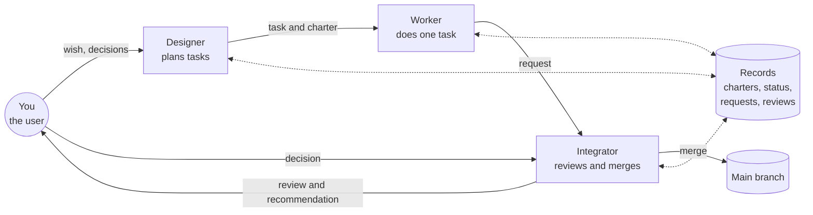

# Partitur

[简体中文](README.zh-CN.md)

A partitur is the full score of a piece: every part, written out, from which
each player reads. Players change; the score stays.

Partitur is a way to run a software project with one person and several AI
agent sessions (Claude Code, Codex, or both). Without it, each session
forgets what it was told when its conversation ends, two sessions change
the same file, and nobody can say later what was agreed and by whom. With
it, each session has one role, everything it needs is kept in files and
Git rather than in a conversation, and nothing reaches a main branch
without a review and your decision. Any session can end at any time, and
the next one picks up from the records.

It is abstracted from the working practice of several real research
software projects, and keeps track of which of its rules have actually
been used in practice.

## You need not read the code

Partitur is used by talking to sessions. Ask a session anything about it,
in your own words: "what does the integrator do?", "how do I stop working
on a task?", "why are you waiting for me?". The session reads Partitur's
documents and explains. Let a session install it, too.

[Getting started](GETTING-STARTED.md) follows one small project from a
wish to a merge, in about ten minutes of reading, and explains the ideas
behind each step.

Who does what (solid arrows: work passes on; dotted: every session reads
and writes the records):

## Start

You need Git 2.28 or later, Python 3.8 or later, and Claude Code, Codex,
or both, on Linux or macOS (on Windows, WSL).

1. **Install.** Start a session in your project's *workspace root*, the
   directory that holds its code checkouts, and say: "Install Partitur for
   this project from https://github.com/QiaoLei-88/Partitur". The session
   says where it will put Partitur and which version, and waits for your
   go-ahead. It then installs with `install --release`, which keeps that
   version in a clone of its own that never changes, and goes through two
   files with you: the project's rules, and the charter of the design
   (what the project is for). It takes no role afterwards.
2. **Open the two standing roles.** In two fresh sessions in the workspace
   root, type `/ptt-take designer` in one and `/ptt-take integrator` in the
   other. In Claude Code, each prints a `/rename` line: type it in that
   session, so that automatic messages from other sessions reach it.
3. **Your first task.** Tell the designer what you need. When you agree on
   a piece of work, it becomes a task; a third session takes it with
   `/ptt-take N` and shows you its plan before writing anything.

From then on, sessions ask you whenever something needs your decision,
with numbered options and their recommendation first. You answer `1 AtE`
("approval to execute", option 1); anything without `AtE` is discussion,
so keep asking until the recommendation is clear.

To update later, ask a session: "Update Partitur for this project to
v0.N". A version is a tag `v0.N` or a commit.

## Everyday commands

| You want to... | In which session | Command |
| --- | --- | --- |
| start the design, or take it over | any free session | `/ptt-take designer` |
| turn a discussion into a task | the designer | `/ptt-mktask`, then `/ptt-mktask release N` |
| have a session work on a task | any free session | `/ptt-take N` (or the task's name), or in a new one the line `ptt ready` printed: `claude -n <name> "/ptt-take N"` |
| know who a session is | any | `/ptt-whoami`; `/ptt-whoami all` for everyone |
| know what is new for a session and what waits on it | any holder | `/ptt-inbox` (with an active prompt hook, it also arrives with your next message) |
| brief me on this session's work and what needs my decision | any holder | `/ptt-brief` |
| send a note from your topic and gist | any | `/ptt-note <recipient>` (designer, integrator, or an open task's ID) |
| continue a role after `/clear` or in a fresh session | the continuing session | `/ptt-resume <name>` (without a name, it lists the holders, the one that left a handover at its quiet point first) |
| submit finished work for review | the task holder | `/ptt-pr-submit` |
| answer a review | the task holder | `/ptt-pr-draft-reply` to see the plan and reply text, then `/ptt-pr-reply` to release it (`/ptt-pr-submit draft` likewise before submitting) |
| review and carry out your decision | the integrator (`/ptt-take integrator`) | `/ptt-pr-review` |
| report a task done / accept it | holder / its supervisor | `/ptt-done` / `/ptt-close N` |
| turn automatic nudges between sessions on or off | any | `/ptt-nudges on` / `/ptt-nudges off` |
| stop holding a role or task | that session | `/ptt-leave` (a task needs the supervisor's `/ptt-leave approve N`) |
| clean up merged branches | the integrator | `/ptt-pr-cleanup` |
| free disk space: your run records, your scratchpad | any holder | `/ptt-disk` |

In Codex, commands start with `$` instead of `/`. For anything not in this
table, ask a session: it reads Partitur's documents and explains, for
example "how does leaving a task work?" or "what does the integrator do?".

`/ptt-pr-review all` reviews the first waiting request per repository in
merge order (lowest number when no order is stated), across repositories
in one run. Other requests in that repository wait to rebase after the
first merges. An overview lists every reviewed or waiting request; each
review and its decision are then discussed in a separate message, waiting
for your answer before the next. `/ptt-pr-reply` likewise handles one
request per message.

## Contents

- [Getting started](GETTING-STARTED.md): the process and its ideas, by
  one example.
- [Release notes](RELEASE-NOTES.md): changes and actions after updating.
- [Rules index](rules.md): every rule with its ID and label: *Exercised*
  (used in practice), *Adopted* (written into a project's rules, not yet
  shown in use), or *Proposed* (Partitur's design, untested).
- For sessions: [SKILL.md](SKILL.md), their entry point;
  [INSTALL.md](INSTALL.md), for installing, updating, and uninstalling;
  [model](model.md), roles ([user](roles/user.md),
  [designer](roles/designer.md), [track](roles/track.md),
  [worker](roles/worker.md), [integrator](roles/integrator.md),
  [delegate](roles/delegate.md)), flows ([roles and tasks](flows/tasks.md),
  [authorization](flows/authorization.md), [requests](flows/requests.md),
  [handoff](flows/handoff.md), [evidence](flows/evidence.md),
  [references](flows/references.md)), and [parameters](parameters.md).
- [Contributing](CONTRIBUTING.md); tests:
  `python3 -m unittest discover -s tests`.

## Licence

Partitur is licensed under the GNU General Public License, version 2 only
(SPDX: `GPL-2.0-only`); see [LICENSE](LICENSE).
