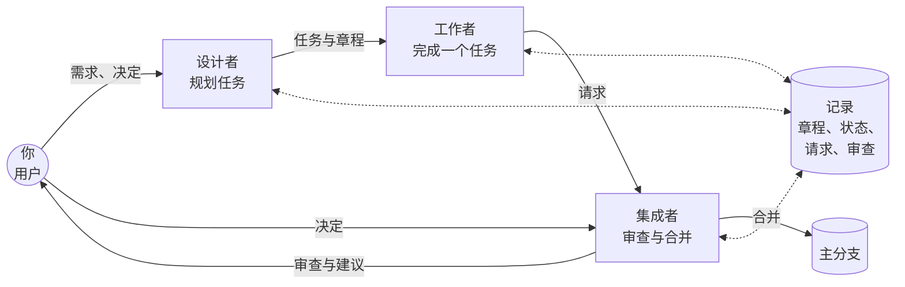

# Partitur

[English](README.md)

Partitur 是乐曲的总谱：每个声部都写在其中，演奏者各自照谱演奏。
演奏者可以更换，乐谱始终保留。

Partitur 是一种由一个人和多个 AI 代理会话共同开展软件项目的方法，
支持 Claude Code、Codex，或两者同时使用。没有它时，会话一结束就忘了交代过的事，
两个会话会改同一个文件，事后也说不清谁同意过什么。有了它，每个会话只担一个角色，
需要的信息都保存在文件和 Git 中，而不是留在对话里；任何改动都要经过审查和你的决定，
才能进入主分支。任何会话都可以随时结束，接替的会话根据记录继续工作。

它提炼自几个真实科研软件项目的工作实践，
并持续记录哪些规则已经在实践中用过。

## 不必读代码

使用 Partitur 的方式就是和会话交谈。关于它的任何问题，都可以用自己的话问会话：
“集成者做什么？”“我怎样退出一个任务？”“你为什么在等我？”
会话会阅读 Partitur 的文档并解释。安装也交给会话来做。

[上手指南](GETTING-STARTED.zh-CN.md)用一个小项目，从一个需求一直走到合并，
大约十分钟读完，并解释每一步背后的道理。

谁做什么（实线：工作的传递；虚线：每个会话都读写记录）：

## 开始

环境要求：Git 2.28 或更高版本、Python 3.8 或更高版本，以及 Claude Code、Codex
或两者；系统为 Linux 或 macOS（Windows 上使用 WSL）。

1. **安装。** 在项目的*工作区根目录*（存放各代码仓库检出的目录）启动一个会话，
   对它说：“Install Partitur for this project from
   https://github.com/QiaoLei-88/Partitur”（用中文说也可以）。会话会告诉你
   它打算把 Partitur 放在哪里、用哪个版本，并等你同意。然后它用
   `install --release` 完成安装：这个版本放在一个专属的克隆里，之后不会再变；
   接着和你一起过两个文件：项目的规则，以及设计章程（项目是做什么的）。
   安装完成后它不担任任何角色。
2. **开启两个常设角色。** 在工作区根目录开两个新会话，一个输入
   `/ptt-take designer`，另一个输入 `/ptt-take integrator`。在 Claude Code 中，
   每个会话都会打印一行 `/rename`：在该会话里输入它，其他会话的自动消息才能送达。
3. **第一个任务。** 把你的需要告诉设计者。你们商定一项工作后，它就成为一个任务；
   第三个会话用 `/ptt-take N` 领取它，在写任何东西之前先给你看计划。

此后，凡是需要你决定的事，会话都会问你，给出编号选项，推荐项排在第一。
你回答 `1 AtE`（approval to execute，批准执行选项 1）；不带 `AtE` 的回答都算讨论，
所以可以一直追问，直到推荐理由清楚为止。

以后要更新时，问会话：“把本项目的 Partitur 更新到 v0.N”。
版本是一个标签 `v0.N` 或一个提交。

## 日常命令

| 你想要…… | 在哪个会话中 | 命令 |
| --- | --- | --- |
| 开始或接手设计工作 | 任意空闲会话 | `/ptt-take designer` |
| 将讨论形成任务 | 设计者 | `/ptt-mktask`，然后 `/ptt-mktask release N` |
| 让会话承担一个任务 | 任意空闲会话 | `/ptt-take N`（也可以使用任务名称）；或者开新会话，粘贴 `ptt ready` 打印的命令：`claude -n <name> "/ptt-take N"` |
| 查看会话的身份 | 任意会话 | `/ptt-whoami`；查看所有人用 `/ptt-whoami all` |
| 查看与会话有关的新记录及待办事项 | 任意持有者 | `/ptt-inbox`（启用提示词钩子后，也会随你的下一条消息送达） |
| 简报本会话的工作及需要我决定的事项 | 任意持有者 | `/ptt-brief` |
| 根据你的话题和要点发送便笺 | 任意会话 | `/ptt-note <收件人>`（designer、integrator 或开放任务的 ID） |
| 在 `/clear` 后或新会话中继续持有原角色 | 继续工作的会话 | `/ptt-resume <名字>`（不带名字时只列出持有者，在安静点留下交接标记的排在最前） |
| 提交已完成的工作供审查 | 任务持有者 | `/ptt-pr-submit` |
| 回复审查意见 | 任务持有者 | 先用 `/ptt-pr-draft-reply` 查看修改计划和回复全文，再用 `/ptt-pr-reply` 发布（提交前同样可以先用 `/ptt-pr-submit draft`） |
| 审查并执行你的决定 | 集成者（通过 `/ptt-take integrator` 领取） | `/ptt-pr-review` |
| 报告任务完成／验收任务 | 持有者／其上级 | `/ptt-done` / `/ptt-close N` |
| 开启或关闭会话之间的自动提醒 | 任意会话 | `/ptt-nudges on` / `/ptt-nudges off` |
| 不再持有角色或任务 | 持有它的会话 | `/ptt-leave`（任务需要上级执行 `/ptt-leave approve N` 批准） |
| 清理已合并的分支 | 集成者 | `/ptt-pr-cleanup` |
| 释放磁盘空间：自己的运行记录和临时目录 | 任何持有者 | `/ptt-disk` |

在 Codex 中，命令以 `$` 开头，而不是 `/`。表格未覆盖的内容可以直接问会话：
它会阅读 Partitur 的文档并解释，例如“如何退出一个任务？”或“集成者做什么？”。

`/ptt-pr-review all` 按合并顺序选取每个仓库的首个待审请求，
未指定顺序时按请求编号从小到大；不同仓库的审查在同一轮完成。
同仓库的其余请求等待首个请求合并后再变基（rebase）。
先用总览列出已审查及等待中的请求，再逐条消息讨论一个请求及其决定，
收到你的答复后才讨论下一个。`/ptt-pr-reply` 同样每条消息只处理一个请求。

## 内容索引

- [上手指南](GETTING-STARTED.zh-CN.md)：用一个例子讲流程和背后的理念。
- [发布说明](RELEASE-NOTES.md)：变更，以及更新后需要做的事。
- [规则索引](rules.md)：每条规则的 ID 和标签：*Exercised（已实践）*
  表示已在实践中用过；*Adopted（已采纳）* 表示已写入某个项目的规则，但尚无使用记录；
  *Proposed（提议中）* 表示 Partitur 提出的设计，尚未验证。
- 给会话看的：[SKILL.md](SKILL.md)，会话的入口；
  [INSTALL.md](INSTALL.md)，安装、更新与卸载；
  [模型](model.md)；角色（[用户](roles/user.md)、[设计者](roles/designer.md)、
  [专题研究者（track）](roles/track.md)、[工作者](roles/worker.md)、
  [集成者](roles/integrator.md)、[受托者](roles/delegate.md)）；
  流程（[角色与任务](flows/tasks.md)、[授权](flows/authorization.md)、
  [请求](flows/requests.md)、[交接](flows/handoff.md)、[证据](flows/evidence.md)、
  [引用](flows/references.md)）；[参数](parameters.md)。
  这些文件只有英文版，以英文版为准。
- [贡献指南](CONTRIBUTING.md)；测试命令：
  `python3 -m unittest discover -s tests`。

## 许可证

Partitur 使用 GNU 通用公共许可证，仅限第 2 版
（SPDX：`GPL-2.0-only`）；详见 [LICENSE](LICENSE)。
